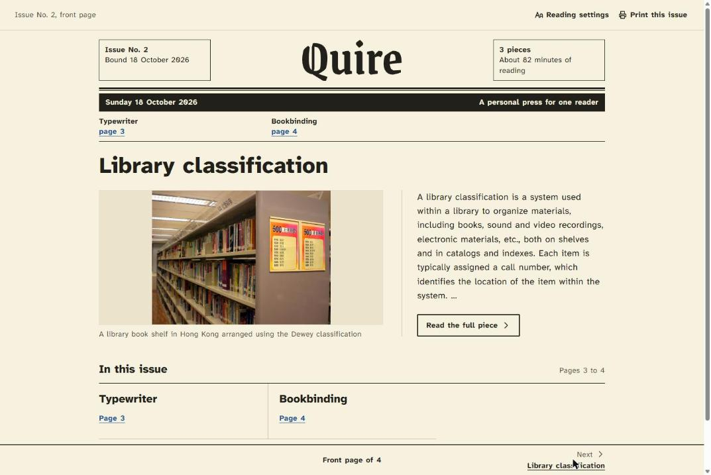
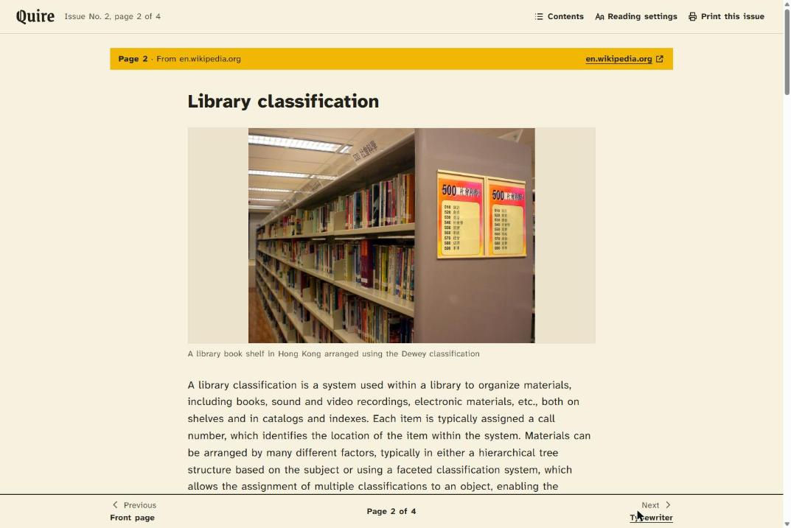
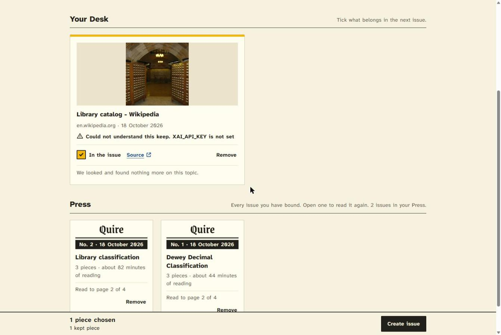
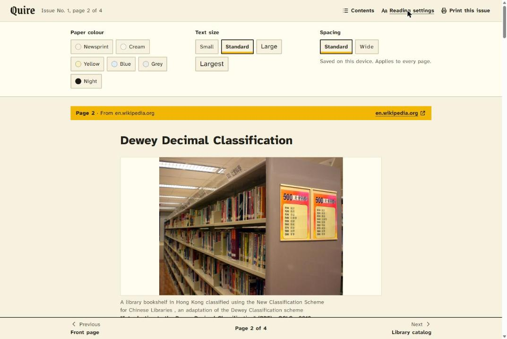
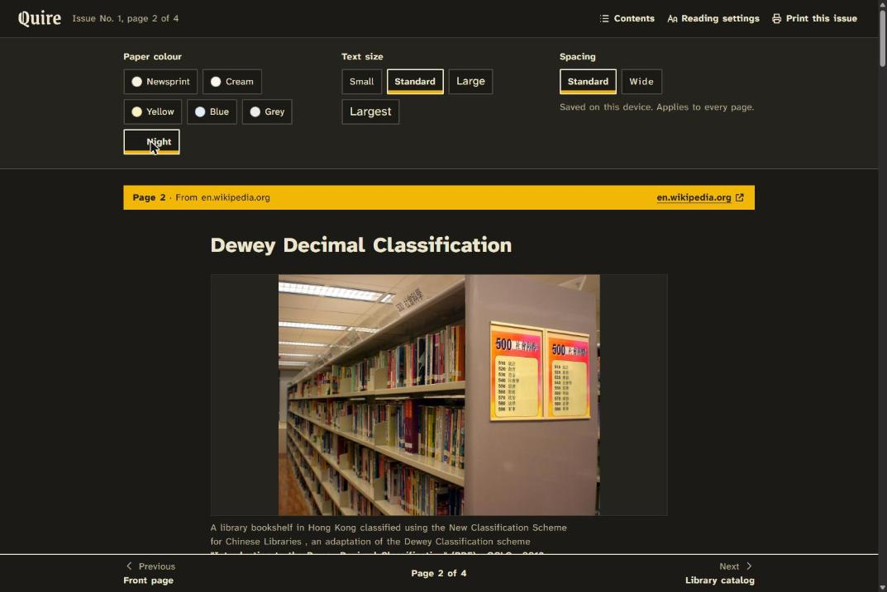
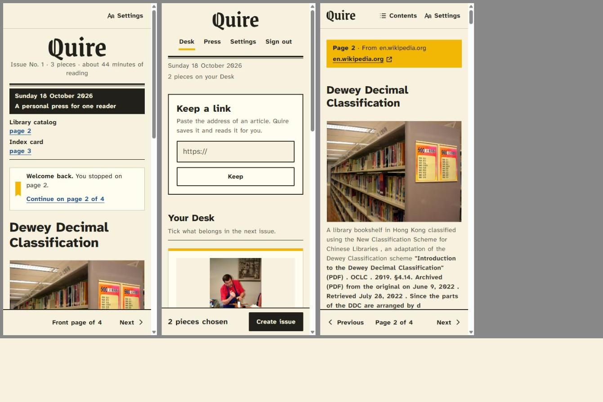

<div align="center">

# Quire

**A personal press for one reader: save the links, bind the issue, read it like a Sunday paper.**

[🎨 Brand guide](docs/brand/README.md) · [📐 Design system](DESIGN.md) · [🧭 Product record](PRODUCT.md) · [🔀 Original project](https://github.com/WilliamGomes41/quire)




</div>

## About

Quire is for people who keep articles to read later and then never do. Paste a link and Quire keeps
it. It reads the page, works out what the piece claims, and looks for other reporting on that claim.
You choose what belongs together and **bind** it into an issue: Quire fetches the authors' own words
and sets them as one issue of your own newspaper.

This is my personal build, a fork of [William Gomes' Quire](https://github.com/WilliamGomes41/quire).
It adds owner sign-in, self-hosting with Postgres, bookmarks, and a new design.

- **Keep:** one paste. The link is saved at once; the card then fills in step by step (headline,
  photo, what the piece claims, more on the topic) while the Desk updates itself.
- **More on this topic:** related reporting found by the piece's central claim, each labelled by
  stance: *Other reporting*, *A contrasting angle* or *Could not place*. Quire never invents a
  related page, and fewer results beat junk.
- **Create issue:** an issue is whatever you tick. The authors' words are fetched once and locked,
  so an issue reads the same tomorrow.
- **Read:** a front page, then one piece per page. Previous / Next, the arrow keys, or the contents.
- **Bookmarks:** Quire remembers the page and the paragraph where you stopped, per reader, so it
  follows you from your laptop to your phone. The Press shows how far you got in each issue.
- **Print this issue:** the same issue as a PDF on A4 or letter.
- **Owner only:** one account, created from the environment on first start. Sign-up is closed.
- **Share and install:** a link to Quire shows a Sunday Bundle preview card, and on a phone's home
  screen Quire has its own Q mark icon.

## The design: the Sunday Bundle

Each issue is set like a British Sunday paper, but read like a page made for dyslexic readers. The
rule of thumb: **the newspaper is the frame, the reading is plain.**

- **The frame is traditional.** A blackletter nameplate, thick-over-thin Oxford rules, ears beside
  the nameplate (issue number, date, pieces, reading time), an ink date bar, a marigold band at the
  head of every piece, an end mark after the last word, and page numbers at the foot.
- **The reading follows the [BDA Dyslexia Style Guide](https://www.bdadyslexia.org.uk).**
  One sans-serif family, [Atkinson Hyperlegible Next](https://www.brailleinstitute.org/freefont/),
  at 19px with a line height of 1.6. One ragged-right column of at most 64 characters. No italics,
  no justified text, no capital-letter labels, no red or green status colours.
- **The reader chooses the paper.** Six paper colours (newsprint, cream, yellow, blue, grey and
  night), four text sizes and wide spacing (the WCAG 1.4.12 values), saved on the device.
- **Marigold is a fill, never text:** the section band, the bookmark ribbon, ticked boxes.
- **The authors' words are never changed.** Quire only sets them. A take, when there is one, is
  labelled *Quire's note* so it is never mistaken for the author.

The brand guide, the approved mockup and the logo files are in [`docs/brand`](docs/brand/README.md);
[`DESIGN.md`](DESIGN.md) describes the tokens and components as built.

## Getting started

Requirements: Node.js 22 or newer.

```bash
npm install
cp .env.example .env   # see below
npm run dev            # http://localhost:3000
```

Without `DATABASE_URL` Quire runs on an in-memory database, which is wiped on every restart. Fine for
trying it out; use Postgres for anything you want to keep.

| Variable | What it's for |
|---|---|
| `BETTER_AUTH_SECRET` | Session signing. Required in production (`openssl rand -hex 32`). |
| `OWNER_EMAIL`, `OWNER_PASSWORD` | The one account, created on first start. Password: 12+ characters. |
| `DATABASE_URL` | Postgres for clips, issues, bookmarks and accounts. |
| `XAI_API_KEY` | Grok, to understand a keep and judge related reporting. Without it, Keep still saves. |
| `SEARCH_API_KEY` | The search API behind *More on this topic*. Without it, the rail stays empty. |

| Command | What it does |
|---|---|
| `npm run dev` | Start the dev server with hot reload |
| `npm test` | Run the Vitest suite |
| `npm run typecheck` | Type-check with `tsc` |
| `npm run build` | Build the Node server and client to `.output/` |

## Project structure

```
src/
├─ routes/
│  ├─ index.tsx        # the Desk: Keep, your clippings, the Press, Create issue
│  ├─ read.$id.tsx     # Read: front page, one piece per page, bookmarks
│  └─ login.tsx        # owner sign-in
├─ lib/
│  ├─ save.ts          # Keep: save first, then fill the card in
│  ├─ related*.ts      # More on this topic: search strings, search, stance
│  ├─ bind.ts          # Create issue: fetch and lock the authors' words
│  ├─ compose.ts       # the reading plan for an issue
│  ├─ print-compose.ts # Print this issue (PDF)
│  └─ bookmark.ts      # where each reader stopped
├─ styles.css          # the Sunday Bundle tokens and components
├─ reading-settings.tsx
└─ copy.ts             # every word Quire itself says
docs/brand/            # brand guide, mockup, logo kit
fonts/                 # Atkinson Hyperlegible Next, for print
tests/                 # Vitest
```

## Deployment

The repo ships a `Dockerfile` (Node server) and a `compose.yml` with Postgres:

```bash
cp .env.example .env   # set the secret, the owner, POSTGRES_PASSWORD and the API keys
docker compose up -d
```

Behind a reverse proxy, set `BETTER_AUTH_URL` to the public address and `AUTH_IP_HEADERS` to the
proxy's client-IP header (for example `cf-connecting-ip`) so sign-in rate limits work.

## More screenshots

| Article page | The Desk |
|---|---|
|  |  |
| **Reading settings** | **Night paper** |
|  |  |
| **On a phone** | |
|  | |

## Credits

Quire was created by [William Gomes](https://github.com/WilliamGomes41/quire); this fork builds on his
product and its protocol. Fonts: [Atkinson Hyperlegible Next](https://github.com/googlefonts/atkinson-hyperlegible-next)
(Braille Institute, SIL OFL) and, for the nameplate only, [Grenze Gotisch](https://fonts.google.com/specimen/Grenze+Gotisch)
(SIL OFL, outlined). Reading guidance: the British Dyslexia Association's *Dyslexia Style Guide*
(2023) and L. Ebbing, *Design of a newspaper for people with dyslexia* (ESAD, 2023). The sample
articles in the screenshots are from Wikipedia (CC BY-SA).

---

<div align="center">

Made by **Anthony Inocencio Ramos** · [anthony-air.nl](https://anthony-air.nl) · [LinkedIn](https://www.linkedin.com/in/anthony-inoc%C3%AAncio-ramos-b89003277/)

</div>
